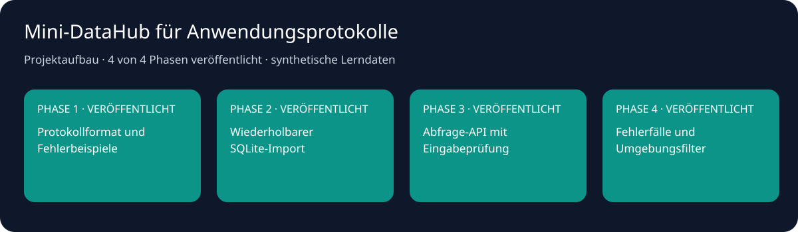

# Mini-DataHub für Anwendungsprotokolle

JSONL-Protokolle sollen wiederholt importiert und je Umgebung ausgewertet werden, ohne Ereignisse zu verdoppeln.



**Veröffentlichungsstand: Phase 4/4.** Dieses eigenständige Repository übernimmt zunächst den bereits lokal committeten Stand. Weitere fachliche Phasen werden im Abstand von mindestens vier Stunden veröffentlicht. Die technische Entwicklung und die öffentliche Veröffentlichung haben unterschiedliche echte Zeitpunkte.

## Was hier zu sehen ist

| Schritt | Inhalt | Hier veröffentlicht |
|---|---|---|
| 1 | Protokollformat und Fehlerbeispiele | Ja |
| 2 | Wiederholbarer SQLite-Import | Ja |
| 3 | Abfrage-API mit Eingabeprüfung | Ja |
| 4 | Fehlerfälle und Umgebungsfilter | Ja |

## Fachlicher Nutzen

ETL, API-Verträge, Idempotenz und strukturierte Fehlerbehandlung.

## Lokal starten

Im geklonten Repository ausführen; die benötigte Laufzeit muss installiert sein. Python-Beispiele verwenden 3.12, Node-Beispiele 24 und C# die im Projekt angegebene .NET-Version. Befehle mit uv laden die dort genau bezeichneten Pakete bei Bedarf.

```powershell
uv run --with fastapi==0.162.2 --with uvicorn==0.54.0 --with httpx==0.28.1 python -X utf8 nachweise/p02-t04-pruefen.py
```

Ausführliche technische Befehle: [START.md](START.md). [Öffentlicher Prüfstand](ABNAHME.json) und [Quellphasen](VERLAUF.json) dokumentieren Herkunft und echte Ausführungsdaten. Eine neue Repositorykopie ist kein neuer nativer Desktoplauf.

## Ergebnis des lokal geprüften Schlussstands

Wiederholte Verarbeitung, Umgebungsfilter und unterschiedliche HTTP-Fehlerfälle tatsächlich geprüft.

## Grenzen

Kleine lokale Datenmenge; keine Elastic-, Cloud- oder Produktionsinstanz.

Eigenes kleines Lernprojekt mit synthetischen Daten, mit KI-Unterstützung entwickelt und geprüft. Keine Aussage über Berufserfahrung, menschliche Arbeitsstunden oder praktische Verwendung weiterer nur geplanter Produkte.

## Entwicklungshistorie

[Entwicklungshistorie](HISTORIE.md): die vorhandenen lokalen Änderungen, ihre ursprünglichen Daten und die spätere GitHub-Übernahme.
